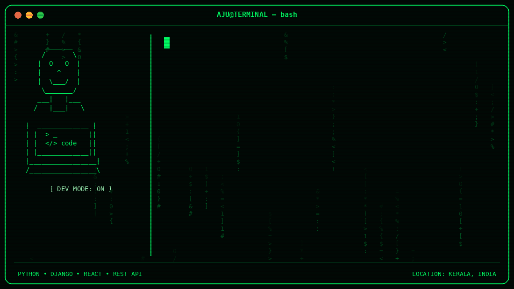

  

# Hi there, I'm Muhammed Ajmal C P 👋

### 🚀 Python Django Full Stack Developer | 📍 Kerala, India

---

### 👨‍💻 About Me
- 💼 **Role:** Python Django Full Stack Developer
- 🌍 **Location:** Kerala, India
- 🎯 Passionate about architecting and building scalable web applications, robust backends, and responsive user experiences.

---

### 🛠️ Skills & Technologies
- **Backend:** Python, Django, REST APIs
- **Frontend:** React.js, HTML5, CSS3, JavaScript
- **Databases:** Microsoft SQL Server, SQLite
- **Tools & Workflow:** Git, GitHub, RESTful Architecture

---

### 📂 Featured Projects
- **Wasla Soft Laundry** – A full-stack laundry and operations management system with robust business logic, inventory, and point-of-sale functionality.
- **AI Life Scheduler** – An intelligent planning and life scheduling application powered by Python and modern workflows.
